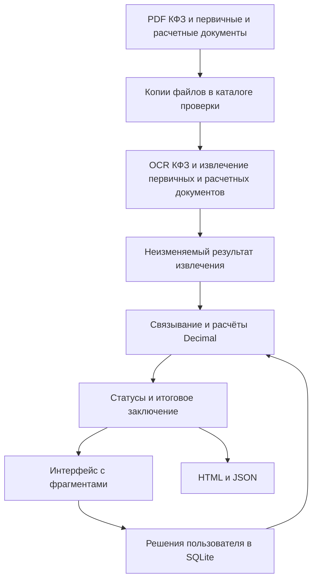

# Архитектура БухРазума

Приложение работает локально и запускается одним процессом Python с вызываемым Node/WASM-движком OCR. Фронтенд — HTML, CSS и JavaScript без сборщика и внешних ресурсов. Хранение — файлы и SQLite, отдельный сервер базы данных не нужен.

## Компоненты

| Файл | Ответственность |
| --- | --- |
| `app/server.py` | HTTP API, очередь проверок, загрузка копий, SQLite, сохранение решений и экспорт |
| `app/engine.py` | Чтение PDF/DOCX/XLSX/PNG, реквизиты, суммы, назначение статей, фильтрация, агрегация и рекомендация |
| `app/ocr.cjs`, `app/offline.cjs` | Локальный Tesseract.js, локальные языковые модели, программный запрет сетевых запросов OCR |
| `app/kfz_layout.py` | Номера столбцов, строка, геометрия и объединения шапки, фрагменты |
| `app/kfz_confirmation.py`, `app/kfz_assemble.py` | Повторное чтение текста без границ, названия по иерархии шапки и признаки сомнительности |
| `app/checks.py` | Пять независимых арифметических формул КФЗ, прямые ссылки на слагаемые и причины OCR |
| `app/evidence.py` | Структурные представления XLSX/DOCX из загруженных копий, точные ячейки/абзацы, привязка слагаемых |
| `app/reporting.py` | Самодостаточный HTML с двумя видами проверок, слагаемыми, внутренними ссылками и изображениями |
| `app/static/` | Выбор документов, параметры проверки, статусы, просмотр источников и уточнения |

## Происхождение данных

Каждая проверка имеет собственный каталог и идентификатор. Загрузка не меняет оригиналы. PDF-сканы распознаются, текстовые PDF извлекаются с сохранением областей сумм, XLSX связываются с листом и ячейкой, DOCX — с абзацем/таблицей. Неизменяемое извлечение хранится отдельно от списка пользовательских решений.

Решения добавляются в таблицу `decisions`, не изменяя `raw` в таблице `checks`. Для вычисления используется последнее решение по конкретному полю, а вся история остаётся доступной. После уточнения результат вычисляется заново. Чтение числа пользователем не заменяет проверку первичными и расчетными документами.

## Проверки и зависимости

Дубли определяются по байтовому хешу и, при наличии реквизитов, по номеру/дате/договору/сумме. Другой договор и дата вне периода исключаются с причиной. Назначение статьи строится по содержанию и явным указаниям, а неоднозначное назначение требует решения пользователя.

Месячная зарплата и взносы проверяются на покрытие месяцев периода. При пропуске ожидаемый итог недоступен. Неизвестное значение не подменяется нулём. Граф зависимостей чтения КФЗ блокирует подтверждение промежуточных и общих итогов при неуточнённых исходных полях. Недостаточная детализация первичных и расчетных документов не мешает отдельно подтвердить доступный агрегат.

Все денежные вычисления выполняются `Decimal`, результаты сравниваются до копейки. Ведомости зарплаты агрегируются из строк начислений, а не пустого кэша `SUM`. Отдельные внутренние разбивки без первичных и расчетных документов остаются непроверенными.

Политика итоговой рекомендации отделена от вычислений и выбирается параметром проверки. Диагностическая сумма статей не должна учитываться как второе независимое расхождение одной и той же операции.

## Арифметика и синхронный просмотр

Версия 0.3.0 возвращает `rows` для сверки с документами и `arithmetic` для пяти формул КФЗ. Для арифметики используется `intrinsic_ready` непосредственно участвующих ячеек, без зависимости от наличия первичных и расчетных документов. Документальные итоги сохраняют свой граф проверки. Разница в обоих разделах — отчёт минус ожидаемое.

В строке документальной сверки `terms` хранит идентификатор источника, компонент, его сумму и локатор. У основной зарплаты это компонент 0201, у объединения 8+9 — 0202, у общих статей — сумма документа. Интерфейс не выводит вместо них общий итог файла. `views` содержит полную страницу с координатами, лист с адресами или структуру абзацев/таблиц. Эти представления строятся из локальных копий и для ранее сохранённых проверок; исходный `raw` не переписывается.

Неподтверждённое чтение, отсутствие числа и отсутствие независимой детализации имеют разные объяснения. 13+14 не вычисляется из общего тарифа или проверяемой суммы; в предоставленном наборе ожидаемой суммы для этой разбивки нет. Диагностический итог ссылается на расхождения статей через `derived_from`; повторного денежного суммирования нет. Правила подробно закреплены в [арифметике и источниках](арифметика_и_источники.md).

## Эксплуатационные границы

Очередь выполняет одну проверку одновременно: это ограничивает конкуренцию за OCR и PDF-движок на ноутбуке. API и данные рассчитаны на локальную однопользовательскую работу. Многопользовательская авторизация, интеграции и автоматический сбор документов не входят в текущий объём.

В контейнер передаются только приложение, модели и зависимости. Пользовательские документы, результаты и контрольный разбор в образ не копируются. Данные сохраняются в каталогах `work/` и `results/` внутри проекта, подключённых к контейнеру. Внешних сервисов в рабочем потоке нет; публичные реестры зависимостей нужны только при сборке.

## Компактное представление 0.3.0

`app/static/report_view.js` и `report.css` — единый renderer для приложения и самодостаточного HTML. Главная таблица содержит четыре статьи и итог. Источники раскрываются под строкой; итог ссылается на статьи. Просмотр фрагмента открывается в закрываемом dialog, без потери раскрытых деталей. Арифметика и внутренние показатели доступны в подробностях. HTML встраивает каждое изображение один раз в карту ресурсов; данные JSON экранируются от закрытия script-тега. Экспорт не требует сети и не меняет пользовательские решения.

Версия 0.3.1: `evidence.report_field_view` добавляет контекст шапки выбранной ячейки к отображаемому результату, включая старые сохранённые проверки. Исходное извлечение не изменяется. Геометрия берётся из распознанной иерархии шапки и координат строки; масштаб выбирается так, чтобы заголовок и число помещались вместе.
